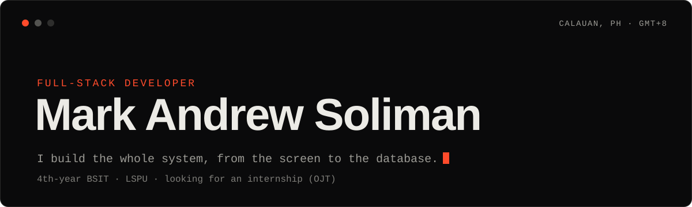

<a href="https://mrkndrwslmn.tech">
  <picture>
    <source media="(prefers-color-scheme: dark)" srcset="assets/banner-dark.svg">
    <source media="(prefers-color-scheme: light)" srcset="assets/banner-light.svg">
    
  </picture>
</a>

 

 

## 👋 Hi, I'm Mark

I'm a fourth-year BSIT student at **Laguna State Polytechnic University** in Calauan, Laguna. Since 2023 I've built **fifteen full-stack projects**: marketplaces, management systems, mobile apps and a logistics platform. Some were coursework, others were for private clients and small businesses.

I plan the database and the user roles before the first screen, put a working prototype in front of the client early, and use Git on every project, including the small ones.

I'm **looking for an internship (OJT)** with a team that builds software people use every day.

 

## 🗂 Selected work

<table>
  <tr>
    <td width="50%" valign="top">
      <b><a href="https://github.com/1nonlylemm/DILG-PDMU-Workspace">PDMU Workspace</a></b> 
      LSPU capstone for DILG Laguna  
      Compliance monitoring across 30 LGUs: OCR-assisted document matching with human approval, 15-day non-compliance notices and a hash-linked audit trail. 10 IT professionals ran 147 test steps with a 100% pass rate; 36 staff rated it 4.30/5. I wrote 359 of 372 commits.  
      <code>Flask</code> <code>React</code> <code>PostgreSQL</code> <code>Celery</code> <code>Redis</code> <code>Docker</code>
    </td>
    <td width="50%" valign="top">
      <b><a href="https://github.com/mrkndrwslmn/Project-Executions-and-Management-System">Project Execution &amp; Management System</a></b> 
      Team of three · public code  
      Clients request services and pay through Maya; providers deliver with tasks, time tracking and wallet payouts. Role-based access control throughout. I wrote 94 of the 115 commits.  
      <code>Maya payments</code> <code>RBAC</code>
    </td>
  </tr>
  <tr>
    <td width="50%" valign="top">
      <b>NOVA</b> 
      Team lead · multi-vendor marketplace  
      A tech marketplace for LSPU with a Flask web app, a Flutter mobile app and a delivery-rider module, built around a green-seller program and mindful-shopping prompts. I led the team and handled the database architecture.  
      <code>Flask</code> <code>Flutter</code> <code>Leaflet</code>
    </td>
    <td width="50%" valign="top">
      <b>Creators' Freelance Marketplace</b> 
      Marketplace · payments  
      Connects Filipino UGC creators, designers and influencers with brands: project briefs, escrow-protected payments, paid subscriptions and content moderation.  
      <code>Escrow</code> <code>Subscriptions</code> <code>Moderation</code>
    </td>
  </tr>
  <tr>
    <td width="50%" valign="top">
      <b>MBDC</b> 
      Client work · franchise site + lead database  
      Marketing site with spam-protected inquiry forms, plus an internal lead database where agents see only their own leads. Built in Node.js first, rebuilt in Laravel, delivered in about a month.  
      <code>Laravel</code> <code>Node.js</code> <code>SQLite</code> <code>DigitalOcean</code>
    </td>
    <td width="50%" valign="top">
      <b>Singy</b> 
      Karaoke party web app  
      A host opens a room on the TV, guests join from their phones with a 4-letter code or QR code, and everyone's picks go into one live queue.
    </td>
  </tr>
</table>

**[See all fifteen projects →](https://mrkndrwslmn.tech/projects)**

 

## 🧰 What I build with

| | |
|---|---|
| **Strongest** |     |
| **Comfortable** |        |
| **Also used** |      |

 

## 🎓 Background

- **BS Information Technology**, Laguna State Polytechnic University, College of Computer Studies (4th year)
- **Freelance full-stack developer**, since 2023: web apps and cross-platform mobile apps for private clients and small businesses
- **17 certifications** from Google (Data Analytics, UX Design, Project Management), AWS, Cisco, IBM, freeCodeCamp and others. [Full list on my resume](https://mrkndrwslmn.tech/resume)

 

## 📬 Let's talk

Hiring an intern, or have a system to build? Email me what you need and I'll reply quickly.

Calauan, Laguna, Philippines · GMT+8

